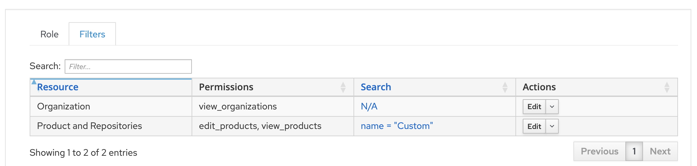

# Hammer

Container wrapping hammer command for Foreman/Katello.

Ping server:
```bash
docker run --rm hammer:latest \
  -s https://foreman.example.com ping
```

Upload packages:
```bash
docker run --rm -v ./:/build -w /build hammer:latest \
  -s https://foreman.example.com -u admin -p password \
  repository upload-content \
  --organization Default --product Custom --name el9 --path 'RPMS/*/*.rpm'
```

To enable upload, create a role *upload* with the following Filters, the search limits upload capabilities to a *Custom* product:



Assign this role to an *upload* user.
